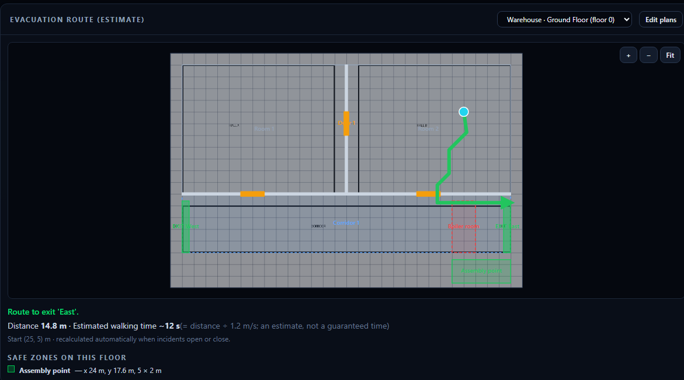
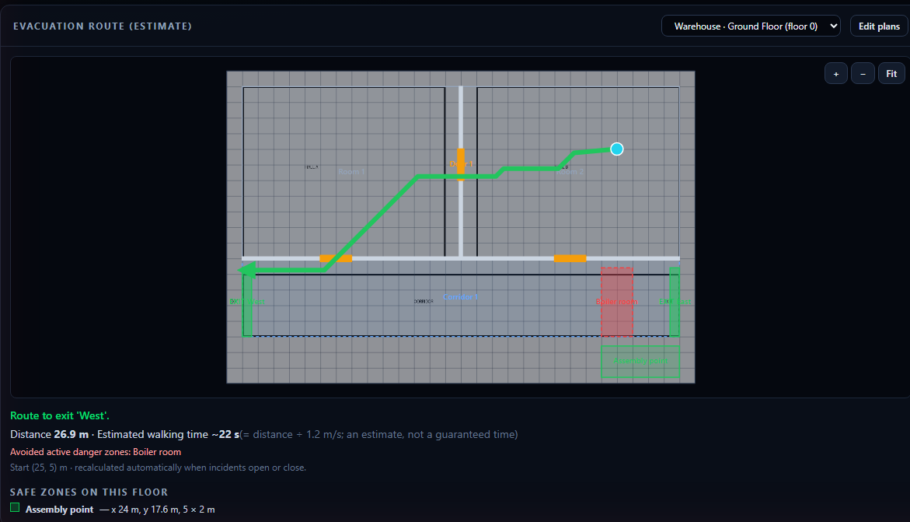
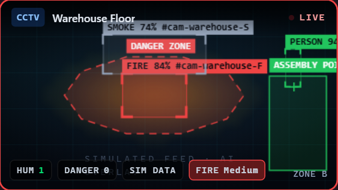
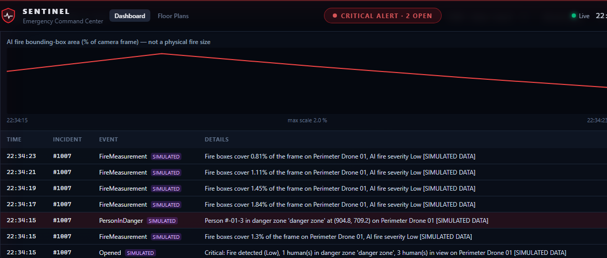
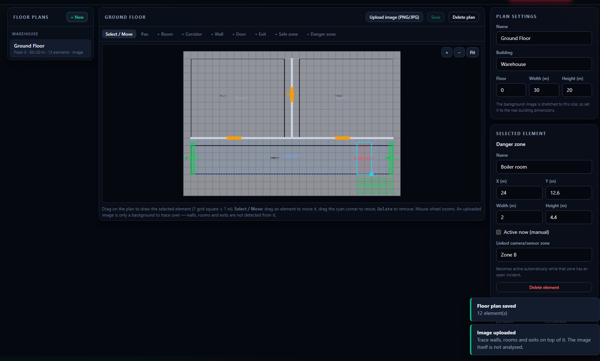

# 1. Project Ka Taaruf Aur Maqsad

**Sentinel** ek fire-safety command center hai. Yeh building ke cameras (CCTV + Drone), dhuwen/garmi ke sensors aur smart sprinklers ko ek screen par jorta hai. Khatra ho to khud alert deta hai, sprinkler chalata hai, log rakhta hai, aur ab **building ke naqshe par mehfooz nikalne ka raasta** bhi dikhata hai.

### Is version (v2) mein naya kya hai

| Naya feature | Requirement | Ek line mein |
|---|---|---|
| **Safe Zones** | 5.2 | Mehfooz ilaqe camera par aur naqshe par **hare rang** mein. Naqshe wale database mein save hote hain |
| **Danger Zone Person Check** | 2.3 | Backend **khud** dekhta hai ke koi insaan danger zone ke andar khara hai, aur alert deta hai |
| **Fire Growth History + Graph** | 3.2 | Har incident ke dauran aag ke napey gaye data ka record aur graph |
| **Fire Growth & Evacuation Logs** | 5.3 | Har waqia (incident khula, barha, band hua, aag ki naap, insaan khatre mein, raasta) log hota hai |
| **Evacuation Route** | 2.4 | Naqshe par insaan ki maloom jagah se qareeb tareen **mehfooz** exit tak raasta (deewar, band darwaze, aag se bach kar) |
| **Estimated Evacuation Time** | 6.4 | Raaste ki lambai ÷ chalne ki raftar = andazan waqt |
| **Floor Plan Upload** | Naya | Apne naqshe ki PNG/JPG tasveer upload karke us ke upar draw karna |
| **Floor Plan Editor** | Naya | Website par khud naqsha banana: rooms, corridors, walls, doors, exits, safe/danger zones |

> ⚠️ **Imandari ki baat:**
> - AI (camera mein aag/insaan pehchaanne wala model) abhi bhi is project mein **nahi** hai.
> - Camera ka data abhi **Simulator** bhejta hai, aur woh har frame par `simulated: true` lagata hai. Isi liye alerts aur logs par **SIMULATED** likha aata hai.
> - Naqshe par insaan ki jagah **haath se (click karke)** di jati hai, kyunke koi indoor tracking hardware maujood nahi.

---

# 2. System Architecture

```
┌──────────────────────┐     REST (HttpClient + JWT)      ┌────────────────────────────────────┐
│ ANGULAR 22 FRONTEND  │ ───────────────────────────────► │ ASP.NET CORE 8 WEB API             │
│ (browser)            │ ◄─────────────────────────────── │  Controllers → Services             │
│  Dashboard           │     SignalR /hubs/monitoring     │  AlertEngine, FloorPlanService,     │
│  Floor Plans editor  │ ◄═══════════════════════════════ │  EvacuationRouter, NotificationWorker│
└──────────────────────┘     (live events)                └──────────────┬─────────────────────┘
                                                                         │ Entity Framework Core
  ┌─────────────────────┐   X-Device-Key (REST/SignalR)                  ▼
  │ AI / Simulator /    │ ──────────────────────────────►   ┌──────────────────────┐
  │ IoT sensors         │                                    │ SQL SERVER (SentinelDb)│
  └─────────────────────┘                                    └──────────────────────┘
```

| Layer | Kya hai | Folder |
|---|---|---|
| Frontend | Angular 22, TypeScript, Tailwind CSS, SVG/Canvas | `frontend/src/app/` |
| Backend | ASP.NET Core 8 Web API, C#, SignalR | `backend/Sentinel.Api/` |
| Database | SQL Server + EF Core migrations | `backend/Sentinel.Api/Migrations/` |
| Simulator | Nakli camera/sensor data (.NET console) | `backend/Sentinel.Simulator/` |
| Tests | xUnit (backend), Vitest (frontend) | `backend/Sentinel.Api.Tests/`, `frontend/src/**/*.spec.ts` |

**Waiter aur chef ki misaal:** Controller "waiter" hai jo request leta hai. Service "chef" hai jo asal kaam karti hai. EF Core "translator" hai jo C# ko SQL mein badalta hai. Naye features bhi isi tarteeb par bane hain. Misaal ke taur par `FloorPlansController` sirf `IFloorPlanService` ko kaam deta hai.

---

# 3. Features Ka Khulasa (Practical Misaalon Ke Saath)

**Misaal ka manzar:** Warehouse ki "Ground Floor" (30 × 20 m) par do hall hain, neeche ek corridor hai, aur dono taraf exits (West, East) hain. Corridor mein ek "Boiler room" danger zone hai, jo camera zone "Zone B" se linked hai.

1. **Aag lagne se pehle:** operator naqshe par Hall B mein (25, 5) m par click karta hai. Raasta: **East exit, 14.8 m, ~12 s**.
2. **Zone B mein aag lagi** (simulator): Zone B ka incident khulte hi "Boiler room" active ho gaya. Dashboard ne raasta **khud dobara nikala**: **West exit, 26.9 m, ~22 s**, Boiler room se bach kar.
3. Camera par aag ke gird laal **danger zone** aur hara **"assembly point" safe zone** bane. Jo insaan danger zone mein khara tha, backend ne usay khud pakra. Uska **"PersonInDanger" log** bana (track id, jagah, zone ke naam aur SIMULATED label ke saath).
4. **Incident History** panel mein aag ki naap (fire box area %) ka graph aur saare logs nazar aaye.





---

# 4. Safe Zones (Requirement 5.2)

**Kya karta hai?** Mehfooz ilaqe (assembly point, bahar ka maidan) **hare rang** mein dikhata hai, taake danger zones (laal) se saaf alag pehchane jayein.

Safe zones **do jagah** se aate hain:

| Jagah | Kahan se data | Save kahan | Dikhta kahan |
|---|---|---|---|
| **Floor plan** | Operator editor mein "+ Safe zone" se banata hai | SQL table `FloorPlanElements` (`Type = 'SafeZone'`) | Floor Plans editor + dashboard ka Evacuation panel (naam aur jagah ki list ke saath) |
| **Camera frame** | AI har frame mein zone bhejta hai: `"level": "Safe"` | Save nahi hota (har frame live) | Camera tile ke canvas par |

**Rang ka farq (file `frontend/src/app/features/dashboard/video-feed/overlay-renderer.ts`):**

- **Safe zone:** hara `rgb(34,197,94)`, **solid** line, halki si mustaqil fill (dhadakta nahi).
- **Danger/Critical zone:** laal, **dashed** chalti hui line, dhadakti fill.



**Backend:** `ZoneLevel` enum mein `Safe` add hua (`backend/Sentinel.Api/Models/Enums.cs`). Safe zones ko kabhi "danger" nahi gina jata (Chapter 5 dekhein).

**Asal ya simulated?** Naqshe ke safe zones operator ka diya hua **asal data** hain. Camera wala "assembly point" abhi **simulator** banata hai (`Sentinel.Simulator/Program.cs`), jab us zone mein aag ho.

---

# 5. Danger Zone Person Check (Requirement 2.3)

**Kya karta hai?** Pehle backend AI ki baat maanta tha (`atRisk: true`). Ab backend **khud hisaab lagata hai** ke insaan danger zone ke andar hai ya nahi.

**Kahan?** `backend/Sentinel.Api/Validators/DetectionPayloadValidator.cs`

**Flow (qadam ba qadam):**

```
AI/Simulator frame ──► DetectionPayloadValidator.Validate()
   1. Har "Human" box ke pair ka point:  x + width/2 ,  y + height   (box ka neeche beech)
   2. Kya yeh point kisi "Danger" ya "Critical" zone polygon ke andar hai?  (ray-casting: Contains())
      - "Warning" aur "Safe" zones ko nahi gina jata
   3. Haan → detection.AtRisk = true,  detection.DangerZone = zone ka label
   4. DangerCount = max(AI ka DangerCount, backend ki ginti)   ← backend kabhi kam nahi ginta
        ▼
AlertEngine.EvaluateDetectionAsync()
   5. DangerCount > 0 → emergency → incident (High/Critical) + SMS/Email/Push + Auto sprinklers
   6. Incident message mein zone ka naam:  "1 human(s) in danger zone 'Lobby fire area' ... [SIMULATED DATA]"
   7. LogFrameAsync(): har (incident, person trackId, zone) ka sirf EK "PersonInDanger" log
        + live event log par laal line
```

**Duplicate se bachao:** Same incident, same person (`trackId`) aur same zone par sirf **ek** `PersonInDanger` log banta hai. Is ke ilawa purane hifazati intezam bhi chalte rehte hain: 2 second ki rok, 90 second ka merge, aur 120 second ka notification cooldown.

**Alert mein kya hota hai?** Incident number, danger zone ka naam, insaan ki jagah (camera frame ke pixels mein, jaise `(904.8, 709.2)`), waqt, aur simulated data ho to `SIMULATED` label.

**Database:** table `IncidentLogs`, `Type = 'PersonInDanger'`, columns `PersonTrackId`, `PersonX`, `PersonY`, `DangerZone`, `Simulated`.

**Asal ya simulated?** Logic asal hai aur test se saabit hai. Insaanon ki jagah abhi simulator deta hai (`simulated: true`). Simulator ab khud `atRisk`/`dangerCount` **nahi** bhejta, taake faisla backend kare.

---

# 6. Fire Growth History Aur Graph (Requirement 3.2)

**Kya karta hai?** Incident ke dauran jo cheezein **asal mein napi ja sakti hain**, unka waqt ke saath record aur graph banata hai.

| Incident ki qisam | Graph mein kya | Kahan se |
|---|---|---|
| Camera (Vision) | **AI fire bounding-box area (% of camera frame)** | `IncidentLogs` → `Type = 'FireMeasurement'`, column `FireAreaPercent` |
| Sensor | Us sensor ki readings (°C / ppm) incident shuru hone ke baad se | Pehle se maujood table `SensorReadings` (API `/api/iot/sensors/{id}/history`) |
| Manual dispatch | Kuch nahi. Screen par likha aata hai ke koi measurement nahi | — |

> ⚠️ Graph par saaf likha hai: **"not a physical fire size"**. Yeh camera tasveer mein aag ke dabbe ka hissa (%) hai, aag ka asal size (m²) nahi.

**Kaise napa jata hai (`AlertEngine.LogFrameAsync`):**

```
FireAreaPercent = (saare "Fire" boxes ka width × height ka jama) ÷ (frameWidth × frameHeight) × 100
```

- Har camera par zyada se zyada ~2 second mein ek dafa (vision throttle ki wajah se).
- Sirf tab save hota hai jab value, AI severity, insaan ya danger ki ginti **badli ho** (duplicate se bachao).

**Live update:** Har naya log SignalR event `incidentLog` se dashboard par foran aata hai (`SignalRService.incidentLog$`).



---

# 7. Fire Growth Aur Evacuation Logs (Requirement 5.3)

**Ek hi table `IncidentLogs`** mein saari history hai:

| `Type` | Kab banta hai | Kis file mein |
|---|---|---|
| `Opened` | Naya incident (camera, sensor ya manual) | `AlertEngine.PublishIncidentAsync` |
| `Escalated` | Darja barha (High → Critical) | same |
| `Resolved` | Operator ne "Resolve" dabaya | `IncidentService.ResolveAsync` |
| `FireMeasurement` | Aag ki naap (Chapter 6) | `AlertEngine.LogFrameAsync` |
| `PersonInDanger` | Insaan danger zone mein (Chapter 5) | same |
| `EvacuationRoute` | Operator ne raasta nikalwaya. Details "ESTIMATE:" ya "No safe route" se shuru hoti hain | `FloorPlanService.RouteAsync` |

**Columns:** `Id`, `IncidentId` (nullable), `Type`, `Timestamp` (UTC), `Zone`, `Details`, `FireAreaPercent`, `FireSeverity`, `HumanCount`, `DangerCount`, `PersonTrackId`, `PersonX`, `PersonY`, `DangerZone`, `Simulated`.

**Dashboard par dekhna:** "Incident History & Logs" panel:

- Upar **incident** (ya "All incidents") aur **event type** ke filter.
- Table mein **SIMULATED** (jamni) aur **ESTIMATE** (neela) labels.

**Duplicate se bachao:**

- `FireMeasurement`: value na badle to save nahi hota.
- `PersonInDanger`: ek person + ek zone = ek log.
- `EvacuationRoute`: pichhla wala bilkul same ho to dobara save nahi hota.

> ⚠️ **"Evacuation" log ka matlab hai raaste ka andaza (estimate)** jo operator ne nikalwaya. Kisi insaan ke asal mein bahar nikalne ki tasdeeq (confirmation) record **nahi** hoti, kyunke us ke liye indoor tracking chahiye. Jo hua hi nahi, woh log nahi hota.

---

# 8. Floor Plan Upload (Option A) — Qadam Ba Qadam

1. Upar menu mein **Floor Plans** par click karein.
2. **+ New** dabayein. "New floor plan" ban jayega (30 × 20 m).
3. Dayen taraf **Plan settings** mein naam, building, floor number, aur **asal size meters mein** likhein (jaise 30 × 20).
4. **Upload image (PNG/JPG)** dabayein aur apni naqshe ki tasveer chunein.
5. Tasveer naqshe ke peechhe halki si dikhegi aur plan ke size par khinch (stretch) jayegi.
6. Ab us ke **upar** rooms, walls, doors aur exits draw karein (Chapter 9).
7. **Save** dabayein.

**Hifazat (backend `FloorPlanService.SaveImageAsync`):**

- Sirf **PNG ya JPG**. File ke andar ke pehle bytes ("magic bytes") check hote hain, naam ya browser ki baat nahi maani jati. Text file ka naam `.png` rakh dein, phir bhi rad ho jati hai.
- Size zyada se zyada **5 MB** (setting `FloorPlans:MaxImageBytes`).
- File ka naam server khud rakhta hai (`{planId}.png`), user ka diya naam istemaal nahi hota.
- Files `backend/Sentinel.Api/App_Data/floorplans/` mein jati hain, jo public web folder nahi hai.
- Tasveer sirf login wale operator ko milti hai (JWT ke saath).

> ⚠️ **Zaroori:** Upload ki hui tasveer sirf **background** hai. System tasveer se deewarein, exits ya raaste **khud nahi** pehchaanta. Raasta sirf wahi elements istemaal karta hai jo aap draw karte hain.

---

# 9. Manual Floor Plan Editor (Option B) — Qadam Ba Qadam



**Toolbar ke tools:**

| Tool | Kaam |
|---|---|
| **Select / Move** | Element par click = chunein. Drag = hilayein. Neeche-dayen **cyan kona** drag = size badlein. `Delete` key = mitayein |
| **Pan** | Naqshe ko pakar kar idhar udhar karein |
| **+ Room / + Corridor** | Chalne ki jagah banayein (drag karke rectangle) |
| **+ Wall** | Deewar. Drag ki simt mein **0.2 m moti** patli line ban jati hai |
| **+ Door** | Darwaza. 0.4 m mota, deewar ke **upar** rakhein. Darwaza deewar mein raasta khol deta hai |
| **+ Exit** | Emergency exit (hara) |
| **+ Safe zone** | Mehfooz ilaqa (hara) |
| **+ Danger zone** | Khatarnak ilaqa (laal) |

**Mukammal qadam:**

1. **+ Room** chunein aur pehla hall drag karein. Doosra hall bhi.
2. **+ Corridor** se gallery banayein.
3. **+ Wall** se halls aur corridor ke darmiyan deewarein banayein.
4. **+ Door** se deewaron par darwaze rakhein. Darwaze ke baghair raasta deewar paar **nahi** kar sakta.
5. **+ Exit** se bahar nikalne ke raaste banayein.
6. **+ Safe zone** se assembly point, aur **+ Danger zone** se boiler room / khatarnak hissa banayein.
7. **Select / Move** se kisi element par click karein. Dayen panel mein:
    - **Name** (jaise "East", "Boiler room").
    - **X, Y, Width, Height** (meters mein, 0.1 m tak).
    - Door/Exit: **Blocked / closed** (band darwaza → raasta nahi guzrega).
    - Danger zone: **Active now (manual)**, ya **Linked camera/sensor zone** (jaise `Zone B`). Us zone mein incident khula ho to yeh khud active ho jata hai.
8. **Save** dabayein. Title par "· unsaved" hat jayega.
9. Baad mein list se plan chun kar dobara khol sakte hain aur edit kar sakte hain. Kai buildings aur floors ka naqsha alag alag rakh sakte hain (list building ke hisaab se group hoti hai).

**Zoom:** mouse wheel, ya **+ / − / Fit** buttons. Ek grid khana = 1 meter. Har cheez 0.1 m par snap hoti hai.

**Backend validation (`FloorPlanService.Apply`):**

- Har element plan ke andar ho.
- Width/height musbat hon.
- Type sahi ho.
- Zyada se zyada 2000 elements.
- Ghalti par **400** aur saaf message, jaise `'Boiler room' lies outside the 20 x 10 m plan.`

---

# 10. Database Models Aur Rishtay

```
FloorPlans (Id, Name, Building, FloorNumber, WidthMeters, HeightMeters, ImageFileName, CreatedAt, UpdatedAt)
   │ 1
   └──* FloorPlanElements (Id, FloorPlanId FK→cascade, Type, Name, X, Y, Width, Height, IsBlocked, IsActive, Zone)

IncidentAlerts (pehle se) ──1───* IncidentLogs (Id, IncidentId FK→cascade, Type, Timestamp, Zone, Details,
                                                FireAreaPercent, FireSeverity, HumanCount, DangerCount,
                                                PersonTrackId, PersonX, PersonY, DangerZone, Simulated)

CameraFeeds, SensorNodes, SensorReadings, SmartSprinklers, Users, PushSubscriptions  (pehle jaise)
```

| Model (C#) | File | Note |
|---|---|---|
| `FloorPlan` | `backend/Sentinel.Api/Models/FloorPlan.cs` | Ek building ka ek floor. Size meters mein |
| `FloorPlanElement` | same file | Har cheez ek seedha rectangle (meters, origin upar-baayen) |
| `IncidentLog` | `backend/Sentinel.Api/Models/IncidentLog.cs` | History ki har line |
| `FloorElementType` | `Models/Enums.cs` | `Room, Corridor, Wall, Door, Exit, SafeZone, DangerZone` |
| `IncidentLogType` | `Models/Enums.cs` | `Opened, Escalated, Resolved, FireMeasurement, PersonInDanger, EvacuationRoute` |
| `ZoneLevel` | `Models/Enums.cs` | `Warning, Danger, Critical, Safe` (`Safe` naya) |

- Enums SQL mein text ki shakal mein save hote hain (`"SafeZone"`).
- Plan delete karne par us ke saare elements aur us ki image file bhi delete ho jati hai.
- Incident ke logs incident ke saath hi rehte hain.

---

# 11. Frontend Se Backend Tak Request Ka Safar

**Misaal: operator naqshe par click karke raasta maangta hai**

```
1. Operator naqshe par click                          (evacuation-panel.component.html)
2. FloorPlanMapComponent pointer → meters mein badla   (shared/components/floor-plan-map.component.ts → toPlan())
3. EvacuationPanelComponent.onPointer() → calculate()
4. MonitoringApiService.route(id, x, y)                → POST /api/floorplans/{id}/route  { "x": 25, "y": 5 }
5. authInterceptor "Authorization: Bearer <JWT>" lagata hai
6. FloorPlansController.Route() → IFloorPlanService.RouteAsync()
7. FloorPlanService: plan + elements load, open incidents ke zones nikale, active danger zones taye kiye
8. EvacuationRouter.FindRoute()  → raasta (Dijkstra)
9. IncidentLogs mein "EvacuationRoute" (ESTIMATE) save + SignalR "incidentLog"
10. Jawab RouteResultDto → Angular → hari teer + "Distance 14.8 m · ~12 s"
11. Kisi zone mein incident khule/band ho → openZonesKey badla → effect() khud step 3 dobara chalata hai
```

**Misaal: AI frame se PersonInDanger tak**

```
Simulator ─SignalR PublishDetection─► EmergencyMonitoringHub → DetectionService.ProcessAsync
  → DetectionPayloadValidator (pair ka point + polygon check) → SignalR "detection" (canvas par amber dabba)
  → AlertEngine.EvaluateDetectionAsync → UpsertIncidentAsync → PublishIncidentAsync (Opened log)
  → LogFrameAsync (FireMeasurement + PersonInDanger logs) → SignalR "incidentLog" + "activity"
```

---

# 12. Evacuation Route Ka Algorithm

**File:** `backend/Sentinel.Api/Services/EvacuationRouter.cs` (pure static class, database ke baghair test hoti hai)

**Qadam:**

1. **Jaanch:** Naqshe mein kam az kam ek Room/Corridor aur ek khula Exit hona chahiye. Warna saaf message.
2. **Grid:** Naqsha 0.5 m ke khanon mein bant jata hai. Bari building ho to khana bara ho jata hai, taake zyada se zyada ~200,000 khane bane.
3. **Har khana:**
    - Khana **chal sakte hain** tab hai jab us ka beech kisi khule Room / Corridor / Door / Exit / SafeZone ke andar ho.
    - Khana **band** hai agar woh:
        - kisi band (Blocked) Door/Exit ko chhoota ho,
        - kisi **Wall** ko chhoota ho aur wahan koi khula Door/Exit na ho (deewar patli hai, is liye "chhoona" check hota hai, sirf beech nahi),
        - kisi **active danger zone** ko chhoota ho.
4. **Active danger zone:**
    - Jis par "Active now" tick ho, **ya**
    - jis ka "Linked zone" (jaise Zone B) mein koi **khula incident** ho.
5. **Start andar khatre mein?** Jis danger zone ke andar insaan khud khara hai, us mein se nikalne ki ijazat hai. Jawab mein `StartInDangerZone = true` aur message "leave immediately".
6. **Dijkstra:** 8 simtein. Seedha kadam = khane ki lambai, tircha kadam = √2 × lambai. Kona kaatna mana hai. **Pehla pohancha hua khula Exit = qareeb tareen pohanch-sakne-wala exit.** Qareeb wala band ho to agla khud mil jata hai.
7. **Raasta:** sirf mor (turning points) rakhe jate hain. Lambai = segments ka jama.

**Jab raasta na mile (asal messages):**

| Halat | Message |
|---|---|
| Naqshe mein room/corridor nahi | `Floor plan has no rooms or corridors, so no walkable area is defined.` |
| Koi khula exit nahi | `Floor plan has no open emergency exit.` |
| Start kisi room/corridor mein nahi | `Start point is not inside a room, corridor or other walkable area.` |
| Start deewar/band darwaze par | `Start point is on a wall, a closed door or inside an active danger zone.` |
| Saare exits kat gaye | `No safe route: every exit is cut off by walls, closed doors or active danger zones.` |
| Start naqshe se bahar | HTTP **400**: `Start point must be inside the floor plan.` |

> Naqsha adhoora ho (deewarein/darwaze nahi banaye) to raasta sirf **wahi** maanta hai jo draw hua hai. Is liye ise "andaza" (estimate) kaha jata hai, "tasdeeq-shuda mehfooz raasta" nahi.

---

# 13. Estimated Evacuation Time — Formula Aur Assumptions

```
Estimated seconds = Distance (meters) ÷ Walking speed (meters/second)
Walking speed (default) = 1.2 m/s   ← aam baaligh insaan ki chalne ki raftar
```

**Misaal:** 26.9 m ÷ 1.2 m/s = **22.4 s → "~22 s"**

- Raftar setting se badalti hai: `FloorPlans:WalkingSpeedMetersPerSecond` (`appsettings.json`), ya `.env` mein `FloorPlans__WalkingSpeedMetersPerSecond=1.0`.
- Raasta badle (incident khula/band hua) to waqt bhi dobara nikalta hai.
- Screen par likha hota hai: *"an estimate, not a guaranteed time"*.
- **Shamil nahi:** dhuwan, bheer, seedhiyan, zakhmi ya buzurg log, ya darwaza kholne ka waqt.
- Raasta na mile to waqt **0** aur koi andaza nahi dikhaya jata.

---

# 14. Ahem Files Ke Paths

### Backend (`backend/Sentinel.Api/`)

| File | Kaam |
|---|---|
| `Controllers/FloorPlansController.cs` | Floor plan CRUD, image, route API |
| `Controllers/IncidentsController.cs` | + `GET /api/incidents/logs` |
| `Services/FloorPlanService.cs` | Validation, image save, active danger zones, route log |
| `Services/EvacuationRouter.cs` | Grid + Dijkstra raasta |
| `Services/AlertEngine.cs` | + `LogFrameAsync`, `AddLogAsync`, Opened/Escalated logs |
| `Services/IncidentService.cs` | + Resolved log, `ListLogsAsync` |
| `Validators/DetectionPayloadValidator.cs` | + danger-zone person check, `Contains()` |
| `Models/FloorPlan.cs`, `Models/IncidentLog.cs`, `Models/Enums.cs` | Naye models/enums |
| `DTOs/FloorPlanDtos.cs` | `FloorPlanDto`, `SaveFloorPlanRequest`, `RouteRequest`, `RouteResultDto`, `IncidentLogDto` |
| `Data/SentinelDbContext.cs` | Naye tables ki configuration |
| `Migrations/20261012171824_FloorPlansAndIncidentLogs.cs` | Naya migration |
| `Configuration/Options.cs` | `FloorPlanOptions` |
| `Hubs/HubEvents.cs` | + `incidentLog` event |

### Frontend (`frontend/src/app/`)

| File | Kaam |
|---|---|
| `shared/components/floor-plan-map.component.ts` | SVG naqsha: zoom, pan, rang, raasta (editor + dashboard dono) |
| `features/floor-plans/floor-plans.component.ts/.html` | Floor Plans page: list, editor, upload, save |
| `features/dashboard/evacuation-panel/` | Dashboard par raasta + ETA + safe zones ki list |
| `features/dashboard/incident-history/` | Logs, filters, graph |
| `core/services/monitoring-api.service.ts` | Naye API methods |
| `core/services/signalr.service.ts` | + `incidentLog$` |
| `features/dashboard/video-feed/overlay-renderer.ts` | Safe zone hara rang |
| `app.routes.ts`, `features/shell/shell.component.html` | `/floor-plans` route aur menu |

### Simulator
`backend/Sentinel.Simulator/Program.cs`: `simulated: true`, "assembly point" safe zone, aur `atRisk`/`dangerCount` bhejna band.

---

# 15. API Reference (Naye Aur Badle Hue)

Sab endpoints **Operator login (JWT)** maangte hain: `Authorization: Bearer <token>`.

| Method | Route | Body | Jawab |
|---|---|---|---|
| GET | `/api/floorplans` | — | `FloorPlanDto[]` |
| GET | `/api/floorplans/{id}` | — | `FloorPlanDto` / 404 |
| POST | `/api/floorplans` | `SaveFloorPlanRequest` | **201** + `FloorPlanDto` / 400 |
| PUT | `/api/floorplans/{id}` | `SaveFloorPlanRequest` (saare elements badal dete hain) | `FloorPlanDto` |
| DELETE | `/api/floorplans/{id}` | — | **204** |
| PUT | `/api/floorplans/{id}/image` | multipart field `file` (PNG/JPG ≤ 5 MB) | `FloorPlanDto` / 400 |
| GET | `/api/floorplans/{id}/image` | — | `image/png` ya `image/jpeg` / 404 |
| POST | `/api/floorplans/{id}/route` | `{ "x": 25, "y": 5 }` (meters) | `RouteResultDto` / 400 |
| GET | `/api/incidents/logs?incidentId=&type=&limit=` | — | `IncidentLogDto[]` (naya pehle, limit 1–1000, default 200) |

**SaveFloorPlanRequest:**
```json
{
  "name": "Ground Floor", "building": "Warehouse", "floorNumber": 0, "widthMeters": 30, "heightMeters": 20,
  "elements": [
    { "type": "Corridor", "name": "Main corridor", "x": 1, "y": 12, "width": 28, "height": 5 },
    { "type": "Exit", "name": "East", "x": 28.4, "y": 12.6, "width": 0.6, "height": 4.4 },
    { "type": "Door", "name": "Door 1", "x": 14.8, "y": 5, "width": 0.4, "height": 2, "isBlocked": false },
    { "type": "SafeZone", "name": "Assembly point", "x": 24, "y": 17.6, "width": 5, "height": 2 },
    { "type": "DangerZone", "name": "Boiler room", "x": 24, "y": 12.6, "width": 2, "height": 4.4, "isActive": false, "zone": "Zone B" }
  ]
}
```

**RouteResultDto (misaal):**
```json
{ "found": true, "message": "Route to exit 'West'.", "path": [[25,5],[...],[1.25,14.75]],
  "distanceMeters": 26.9, "estimatedSeconds": 22.4, "walkingSpeedMetersPerSecond": 1.2,
  "exitName": "West", "startInDangerZone": false, "activeDangerZones": ["Boiler room"] }
```

**Detection payload mein naya (AI / simulator ke liye):**

- `"simulated": true`: test data ka nishaan.
- `dangerZones[].level` ab `"Safe"` bhi ho sakta hai.
- Jawab / broadcast mein `detections[].dangerZone`: backend batata hai ke insaan kis zone mein hai.

**SignalR:** naya server event `incidentLog` (payload = `IncidentLogDto`).

---

# 16. Database Migration Aur Setup

**Naya migration:** `20261012171824_FloorPlansAndIncidentLogs`. Yeh 3 tables banata hai: `FloorPlans`, `FloorPlanElements`, `IncidentLogs`.

```powershell
cd <project folder>\backend
dotnet ef database update --project Sentinel.Api
```

- Purana database ho to sirf naya migration lagega. Purana data (cameras, sensors, incidents) mehfooz rehta hai.
- `dotnet ef` na mile to: `dotnet tool install --global dotnet-ef`

**Settings (`appsettings.json` → `FloorPlans`):**

| Key | Default | Matlab |
|---|---|---|
| `WalkingSpeedMetersPerSecond` | `1.2` | ETA ki raftar |
| `ImageDirectory` | `App_Data/floorplans` | Upload images ka folder (API folder ke andar) |
| `MaxImageBytes` | `5242880` | 5 MB |

> `App_Data/` mein users ki upload ki hui files hoti hain, unhein git mein commit na karein. Is computer par yeh folder `.git/info/exclude` mein daal diya gaya hai.

---

# 17. Run Aur Test Karne Ki Commands

```powershell
# 1) Backend
cd <project folder>\backend
dotnet restore
dotnet build
dotnet ef database update --project Sentinel.Api
dotnet run --project Sentinel.Api --launch-profile http        # http://localhost:5291/swagger

# 2) Frontend (nayi window)
cd <project folder>\frontend
npm install
ng serve                                                        # http://localhost:4200

# 3) Simulator — Zone B mein aag (nayi window)
cd <project folder>\backend
dotnet run --project Sentinel.Simulator -- --device-key <.env ka Device__ApiKey> --ignite "Zone B"
```

**Tests:**

```powershell
cd <project folder>\backend ; dotnet test                    # 33 tests
cd <project folder>\frontend ; ng test --watch=false          # 16 tests
cd <project folder>\frontend ; ng build                       # production build
```

| Test file | Kya check karta hai |
|---|---|
| `Sentinel.Api.Tests/EvacuationRouterTests.cs` | Seedha raasta, danger zone se bach kar doosra exit, band vs khula darwaza, exit na hona, start bahar, start danger ke andar, backend ka person check (danger vs safe zone) |
| `Sentinel.Api.Tests/FloorPlanAndLogTests.cs` | Plan CRUD, galat geometry → 400, PNG upload theek / nakli PNG rad, image download, ETA formula, Zone C incident par route badalna, route logs (duplicate nahi), delete. Danger-zone person: incident Critical + zone ka naam + SIMULATED, sirf ek PersonInDanger log, FireMeasurement 1.09% |
| `frontend/.../floor-plans/floor-plans.spec.ts` | Drawing ka hisaab (snap, clamp, wall 0.2 m), graph ka hisaab |

---

# 18. UI Istemaal — Qadam Ba Qadam

**A. Naqsha banana**

1. Login karein (`admin@sentinel.local` / `.env` ka password).
2. **Floor Plans** → **+ New** → Plan settings bharein.
3. (Ikhtiyari) **Upload image** se apni naqshe ki tasveer daalein.
4. Tools se Rooms, Corridor, Walls, Doors, Exits, Safe zone, Danger zone banayein → **Save**.

**B. Danger zone ko camera zone se jorna**

- Danger zone chunein → **Linked camera/sensor zone** = `Zone B` → **Save**.

**C. Raasta dekhna (Dashboard)**

1. **Dashboard** par neeche **Evacuation Route (estimate)** panel.
2. Upar se floor plan chunein.
3. Insaan ki **maloom jagah** par click karein → hari teer, faasla aur andazan waqt.
4. Neeche **Safe zones on this floor** mein har safe zone ka naam aur jagah.

**D. Aag ka manzar (demo)**

1. Simulator chalayein: `--ignite "Zone B"`.
2. Camera tile par laal danger zone + hara "assembly point" + "SIM DATA" chip.
3. Evacuation panel khud naya raasta dikhata hai, jo "Boiler room" se bachta hai.
4. **Incident History & Logs** mein incident chunein → graph + logs (PersonInDanger, FireMeasurement…).

---

# 19. Requirements Ka Status

**Kul 26 points: ✅ 17 · ⚠️ 3 · ❌ 6** (pehle ✅ 11 · ⚠️ 7 · ❌ 8)

| # | Requirement | Status | Note |
|---|---|---|---|
| 1.1 | Video se aag/dhuwan pehchaanna | ❌ | AI model nahi |
| 1.2 | Boxes/heatmap se dikhana | ✅ | |
| 1.3 | Mukhtalif mahol mein test | ❌ | AI model nahi |
| 1.4 | Accuracy | ❌ | AI model nahi |
| 2.1 | Insaan pehchaanna | ❌ | AI model nahi (dikhana ✅) |
| 2.2 | Insaan ko track karna | ⚠️ | `trackId` + smooth movement. Asal tracker AI mein |
| 2.3 | Danger zone mein insaan | ✅ **naya** | Backend ka apna polygon check + ek alert per person/zone. Data abhi simulated |
| 2.4 | Evacuation raasta | ✅ **naya** | Naqshe par Dijkstra. Start point haath se (indoor tracking nahi) |
| 2.5 | Khatre wale saaf nishaan-zada | ✅ | |
| 3.1 | Aag small/medium/large | ⚠️ | Backend levels samajhta hai. Level AI ko dena hai |
| 3.2 | Aag ka barhna monitor | ✅ **naya** | Fire-box area % + sensor readings ka graph. Physical size nahi |
| 3.3 | Agle ilaqon ka prediction | ❌ | ConvLSTM/GNN nahi |
| 3.4 | Risk heatmap banana | ⚠️ | Dikhana ✅. Banana AI ka kaam |
| 3.5 | Early warning | ✅ | |
| 4.1–4.4 | Alerts | ✅ | Asal SMS/Email/Push credentials ke baghair test nahi hue |
| 5.1 | Live video par nishaan | ✅ | Asli camera test nahi hua |
| 5.2 | Safe zones | ✅ **naya** | Naqshe (DB) + camera, hara rang |
| 5.3 | Logs: alerts, aag, evacuation | ✅ **naya** | Evacuation = raaste ka andaza; asal bahar nikalna track nahi hota |
| 5.4 | Saaf dashboard | ✅ | |
| 6.1 | Drone feeds | ✅ | |
| 6.2 | IoT/sprinkler simulation | ✅ | |
| 6.3 | Explainable AI | ❌ | |
| 6.4 | Evacuation time | ✅ **naya** | Faasla ÷ 1.2 m/s, "estimate" label |

---

# 20. Maloom Hadood (Limitations) Aur Aage Ka Kaam

**Abhi ki hadood:**

- **AI model nahi:** camera ka data simulator ka hai (SIMULATED label ke saath).
- **Insaan ki jagah naqshe par haath se:** camera pixels ko building ke meters mein badalne ka koi tareeqa (calibration) abhi nahi. Is liye camera wale "person in danger" aur naqshe wale raaste alag alag hain.
- **Naqsha sirf seedhe rectangles:** gol ya tircha kamra nahi bana sakte. Har deewar ek seedhi patti hai.
- **Tasveer se khud deewarein nahi pehchaani jatin.**
- **ETA saada andaza hai:** dhuwan, bheer, seedhiyan shamil nahi. Floors ke beech (staircase) raasta nahi jurta. Har floor alag hai.
- **Ek server process:** duplicate-rok aur cooldown ek hi API process mein kaam karte hain.
- **Asal SMS/Email/Push aur asli camera** credentials/hardware ke baghair test nahi hue.

**Aage kya ho sakta hai:**

1. Python AI service (YOLOv8 + OpenCV). Jab yeh jur jaye, simulator ki zaroorat sirf demo ke liye rahegi.
2. Camera ↔ naqsha calibration (4 points se homography), taake camera wala insaan khud naqshe par aaye aur raasta khud nikle.
3. Polygon (tircha) rooms, aur floors ke beech seedhiyon ka jor.
4. Bheer aur dhuwen ke hisaab se raftar kam karna.
5. Rescue team ko raasta SMS mein bhejna.
